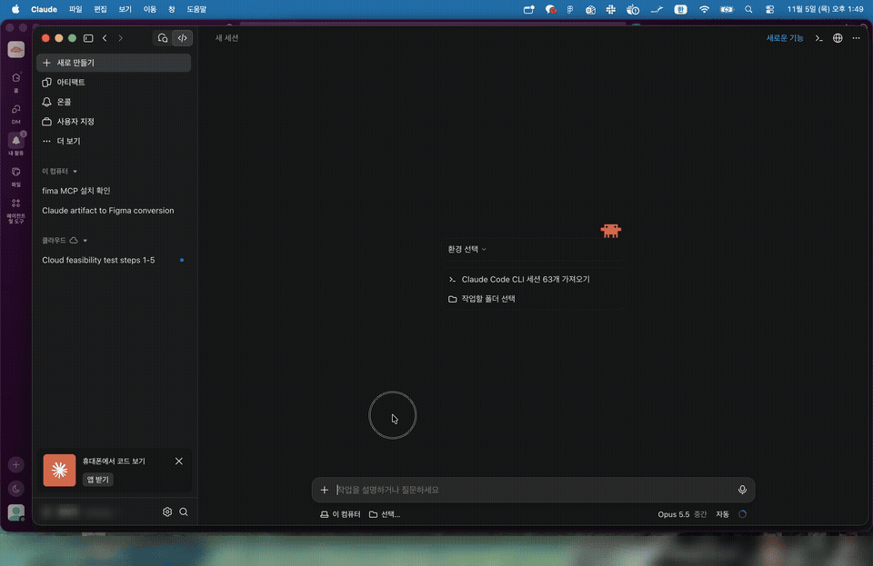

# Quick Capture

화면 일부를 드래그해서 캡처하고, 바로 코멘트를 달고, `↩` 한 번으로 **이미지 + 코멘트를 함께 복사**하는 macOS 메뉴 막대 앱입니다. Claude 데스크톱이나 claude.ai에 `⌘V` 한 번이면 잘린 이미지와 코멘트가 같이 들어갑니다. 터미널(Claude Code CLI)에 붙여넣으면 코멘트와 이미지 파일 경로가 들어갑니다.



[Show & Tell](https://github.com/jonathan-oralart/show-and-tell)(MIT)을 고쳐 만들었습니다.

## 설치

**요구 사항**: macOS 26.4 이상

### Claude Code로 설치 (추천)

Claude Code에 이 저장소 링크를 주고 "설치해줘"라고 하면 됩니다. Claude Code는 아래 [에이전트용 설치 절차](#에이전트용-설치-절차)를 따르면 됩니다.

### 직접 설치

터미널에서 실행합니다.

```sh
curl -fL -o /tmp/QuickCapture.zip https://github.com/KirschX/quick-capture/releases/latest/download/QuickCapture.zip
osascript -e 'quit app id "com.kirschx.quickcapture"' 2>/dev/null || true
rm -rf "/Applications/Quick Capture.app"
ditto -x -k /tmp/QuickCapture.zip /Applications
xattr -dr com.apple.quarantine "/Applications/Quick Capture.app" 2>/dev/null || true
open "/Applications/Quick Capture.app"
```

### 처음 실행할 때 권한 2개 허용 (사람이 직접)

앱이 권한 안내 창을 띄웁니다. 각 항목의 **Open Settings**를 누르고, 목록에 **Quick Capture**를 추가한 뒤 스위치를 켭니다.

1. **화면 및 시스템 오디오 녹음**: 화면을 캡처하는 데 필요합니다. 켜면 앱이 종료되니 다시 실행합니다.
2. **손쉬운 사용**: 마우스 트리거와 Claude 입력창 포커스에 필요합니다.

> 서명은 애드혹(개발자 인증서 없음)입니다. 새 버전으로 업데이트하면 macOS가 새 앱으로 인식하므로 권한 2개를 다시 허용해야 합니다. 시스템 설정에 스위치가 켜져 있는데도 안 되면, 목록에서 Quick Capture를 `−`로 지우고 다시 추가하세요.

## 사용법

1. 캡처할 화면 위에서 **마우스 좌우 버튼을 동시에 클릭**하거나 **`⌘⇧2`**를 누릅니다. 마우스가 있는 모니터가 멈춥니다.
2. 원하는 영역을 **드래그**하면 코멘트 입력창이 바로 열립니다.
3. 코멘트를 쓰고 **`↩`**를 누르면 복사됩니다. `⌘↩`를 누르면 복사한 뒤 Claude 데스크톱이 앞으로 나옵니다.
4. 붙여넣을 곳에서 **`⌘V`**를 누릅니다.

| 조작 | 동작 |
|---|---|
| 박스 여러 개 | 박스를 하나 그리고 코멘트를 쓴 뒤 이어서 다음 박스를 드래그합니다. 모든 박스를 포함하는 영역 1장과 `1. … 2. …` 코멘트가 복사됩니다 |
| `⇧↩` | 코멘트 줄바꿈 |
| 클릭 (드래그 없이) | 번호 핀. 코멘트 없는 핀은 복사할 때 빠집니다 |
| `Esc` | 코멘트 창 닫기. 한 번 더 누르면 캡처 종료(최근 항목에 저장) |
| `⌘⌫` | 저장하지 않고 닫기 |

**붙여넣는 곳에 따라 들어가는 내용**

| 붙여넣는 곳 | 결과 |
|---|---|
| Claude 데스크톱, claude.ai, 브라우저 | 잘린 이미지 첨부 + 코멘트 |
| 터미널(Terminal, iTerm, Ghostty, Warp, Orca 등), VS Code, Cursor, Zed | 코멘트 + 이미지 파일 경로 (`~/Library/Caches/com.kirschx.quickcapture/clipboard/…png`, 최근 30개 유지) |

**설정** (메뉴 막대 아이콘 → Settings…, 또는 앱을 다시 실행)
- 캡처 단축키 변경
- 마우스 트리거: 좌우 동시 클릭(기본값) / 좌우 0.2초 누르기 / 휠 클릭 / 사이드 버튼 / 끄기

## 에이전트용 설치 절차

Claude Code 같은 에이전트가 사용자의 맥에 설치할 때의 절차입니다.

1. `sw_vers -productVersion`으로 macOS가 26.4 이상인지 확인합니다. 낮으면 설치하지 말고 사용자에게 알립니다.
2. 위 [직접 설치](#직접-설치)의 명령을 그대로 실행합니다. 이미 설치되어 있으면 종료하고 교체합니다.
3. 앱이 실행되면 권한 안내 창이 뜹니다. 권한은 macOS가 사용자 본인만 켤 수 있게 막아 두었으므로, 사용자에게 [권한 2개 허용](#처음-실행할-때-권한-2개-허용-사람이-직접)을 안내합니다. 화면 기록을 켜면 앱이 종료되니, 사용자가 켰다고 하면 `open "/Applications/Quick Capture.app"`로 다시 실행합니다.
4. 마지막으로 [사용법](#사용법)의 1~4단계를 사용자에게 짧게 알려줍니다. 앱 아이콘은 Dock이 아니라 메뉴 막대에 있습니다.

## 소스에서 빌드

Xcode와 XcodeGen(`brew install xcodegen`)이 필요합니다.

```sh
scripts/dev.sh   # Debug 빌드를 /Applications/Quick Capture Dev.app 으로 설치하고 실행
```

## 원본에서 바꾼 점

- 캡처 대상: 맨 앞 창 → 마우스가 있는 화면 전체
- 코멘트 입력 중 `↩`: 줄바꿈 → 복사 (한글 조합 중인 글자는 확정한 뒤 복사)
- 복사 결과: 노트를 그려 넣은 이미지 1장 → 마킹한 영역만 자른 이미지 + 코멘트 텍스트를 같은 클립보드 항목에 함께
- 터미널에 붙여넣을 때 이미지 파일 경로 추가
- 마우스 트리거 추가
- 번들 ID 변경(`com.kirschx.quickcapture`), 애드혹 서명, 자동 업데이트 피드 제거

## 라이선스

MIT. 원작자의 저작권 표시는 [LICENSE](LICENSE)에 있습니다.
